<p align="center">
  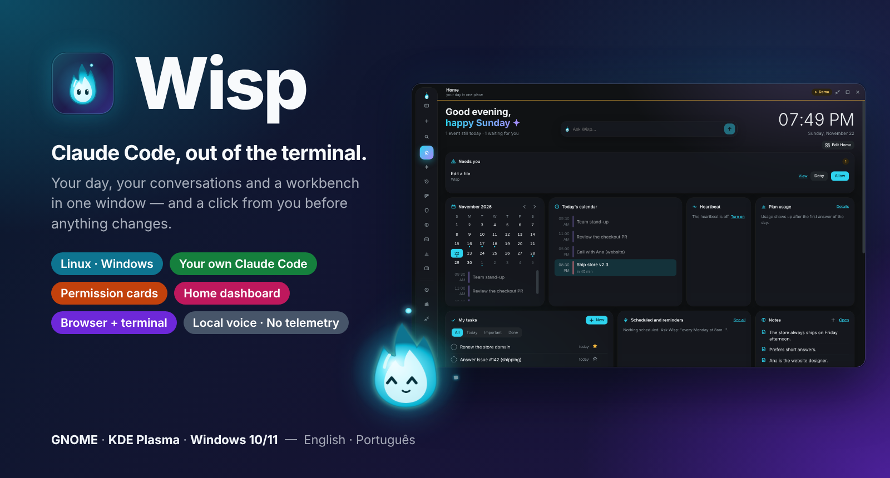
</p>

<p align="center">
  <a href="https://github.com/rempel/wisp/releases"></a>
  <a href="https://github.com/rempel/wisp/actions/workflows/ci.yml"></a>
  <a href="LICENSE"></a>
  
  
  
  
</p>

<p align="center">
  <b>Claude Code, out of the terminal.</b><br>
  A little will-o'-the-wisp that floats on your desktop, chats with you and works on your computer —<br>
  with your own <code>claude</code>, your subscription, and a click from you before anything changes.
</p>

<p align="center">
  <a href="#-features">Features</a> ·
  <a href="#-a-tour">Tour</a> ·
  <a href="#-install">Install</a> ·
  <a href="#%EF%B8%8F-settings">Settings</a> ·
  <a href="#-recipes">Recipes</a> ·
  <a href="#-faq">FAQ</a> ·
  <a href="#%EF%B8%8F-development">Development</a> ·
  <a href="docs/GUIA.md">Full guide (pt-BR)</a> ·
  <a href="#-português">Português</a>
</p>

---

## ✨ Features

<table>
  <tr>
    <td width="33%" valign="top">
      <h3>🔥 Always at hand</h3>
      A click on the mascot, <b>Ctrl+Alt+W</b> from anywhere, or your voice opens the chat. The mascot
      shows what's going on — thinking, talking, <b>waiting for you</b>, done, failed — without you
      looking at the panel. Prefer something quieter? Swap it for <b>the island</b> at the top of the screen.
    </td>
    <td width="33%" valign="top">
      <h3>🧠 The real Claude Code</h3>
      Wisp doesn't talk to an API on its own: it runs <b>your <code>claude</code></b>, with its tools, permission
      modes, skills, plugins, <code>CLAUDE.md</code> and sessions. A tab can even switch to <b>terminal mode</b> and
      show the actual Claude Code TUI.
    </td>
    <td width="33%" valign="top">
      <h3>🛡️ Nothing changes without a click</h3>
      Every command, edit or app launch becomes a <b>card with Allow and Deny</b> — edits come with the diff.
      Modes that allow more are your choice, per conversation, always visible.
      Skipping all permissions doesn't exist in Wisp.
    </td>
  </tr>
  <tr>
    <td valign="top">
      <h3>🧪 A workbench beside the chat</h3>
      A built-in <b>browser</b> and <b>terminal</b> next to the conversation: run the project, see the page,
      point at an element, read the console. Claude can use both when you ask, plus <b>Changes</b> and
      <b>Plan</b> tabs.
    </td>
    <td valign="top">
      <h3>🖥️ A desktop assistant</h3>
      Opens apps, links and projects in your editor, brings windows to the front, takes screenshots,
      controls the music, sets reminders, reads your <b>calendar</b> and watches your <b>PRs' CI</b> —
      on GNOME, KDE Plasma and Windows.
    </td>
    <td valign="top">
      <h3>🔒 Yours, and only yours</h3>
      <b>No telemetry.</b> Voice is transcribed on your machine (whisper.cpp). Secrets live in the
      system keyring. No config file of yours changes without a diff and a backup. Idle, it uses no
      noticeable CPU.
    </td>
  </tr>
</table>

Also: a **full window** with a sidebar, **Home** and categorized settings, **personal memory** that
Wisp keeps on its own (with search by meaning), a daily **Wisp** conversation, a **heartbeat** that checks
your day, **Telegram**, skills it learns from your habits, up to **8 conversations side by side**, conversations in their own **Git worktree**, a **task board**
that runs each card in its own copy, **review & undo** at the end of each reply, a **command palette**,
**saved prompts** and **scheduled tasks**, **approve from your phone** (ntfy) or **chat from your phone** on
your home network, **31 emotions** and **11 dances** for the mascot, a **demo mode** to try it without
Claude Code, and the whole interface in **English** and **Português do Brasil**.

## 📸 A tour

### The full window

Two modes, your choice: the **compact panel** beside the mascot, or a **full window** with a sidebar —
new conversation, search across everything you've said, Home, the Wisp conversation, your projects and
recent conversations. **Home** puts your day in one place (calendar, upcoming tasks and reminders,
GitHub, plan usage, the last heartbeat and what Wisp remembered), and the settings open one category at
a time, with search.

<p align="center">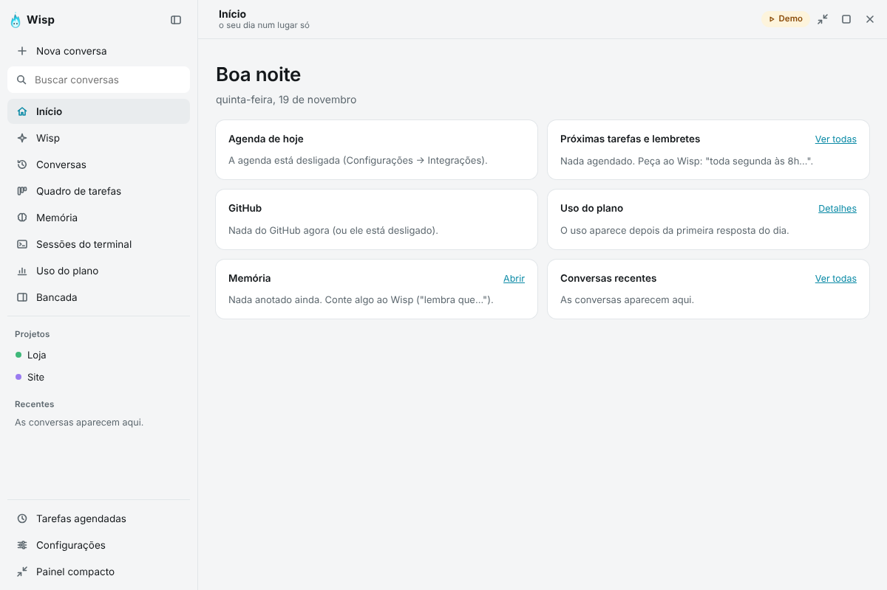</p>

<table>
  <tr>
    <td width="50%">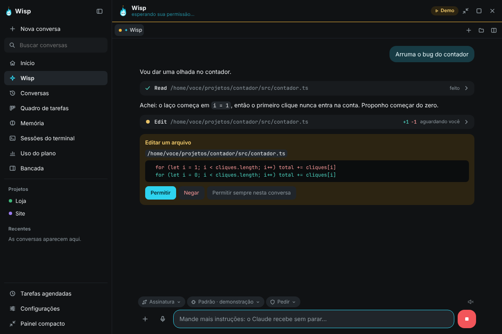</td>
    <td width="50%">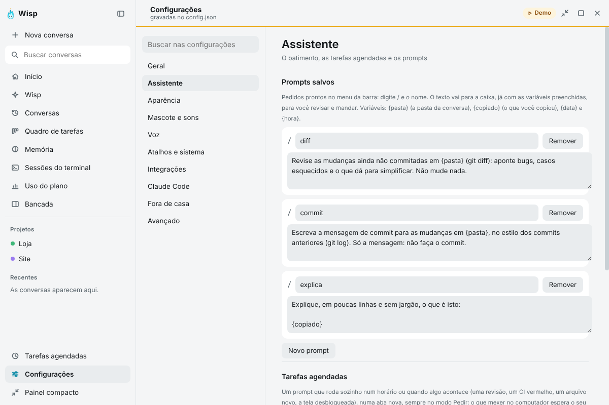</td>
  </tr>
</table>

<table>
  <tr>
    <td width="33%">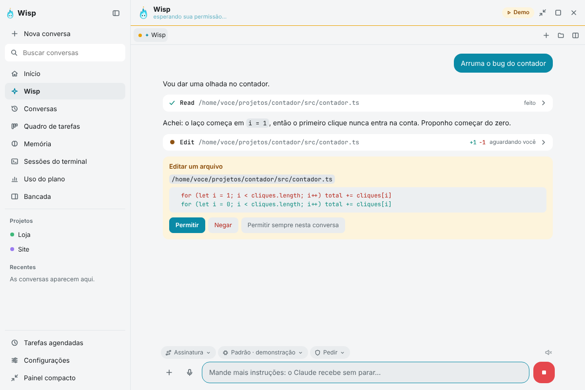</td>
    <td width="33%">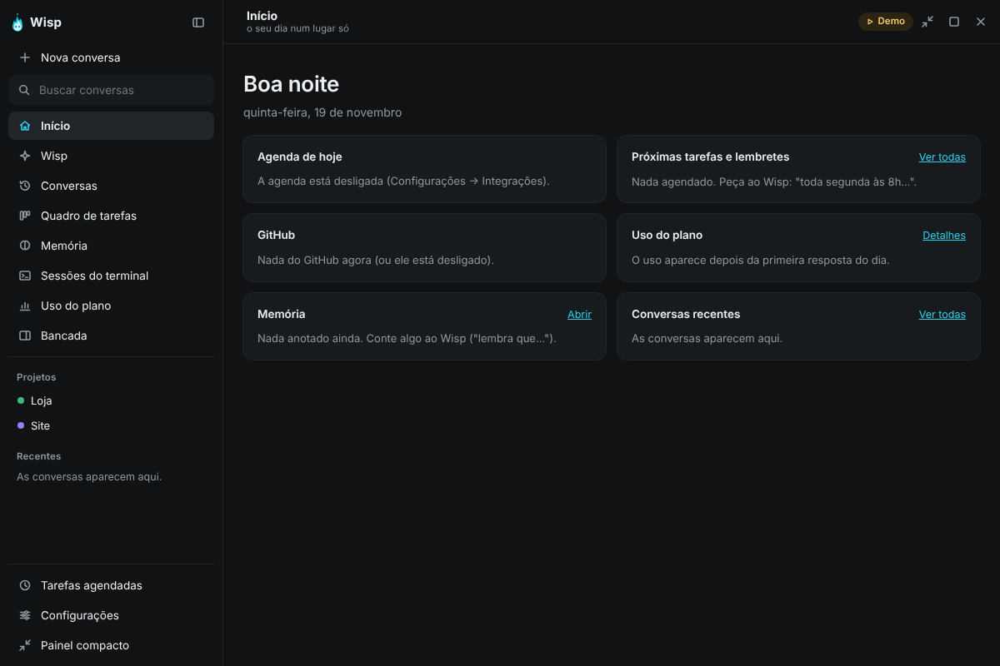</td>
    <td width="33%">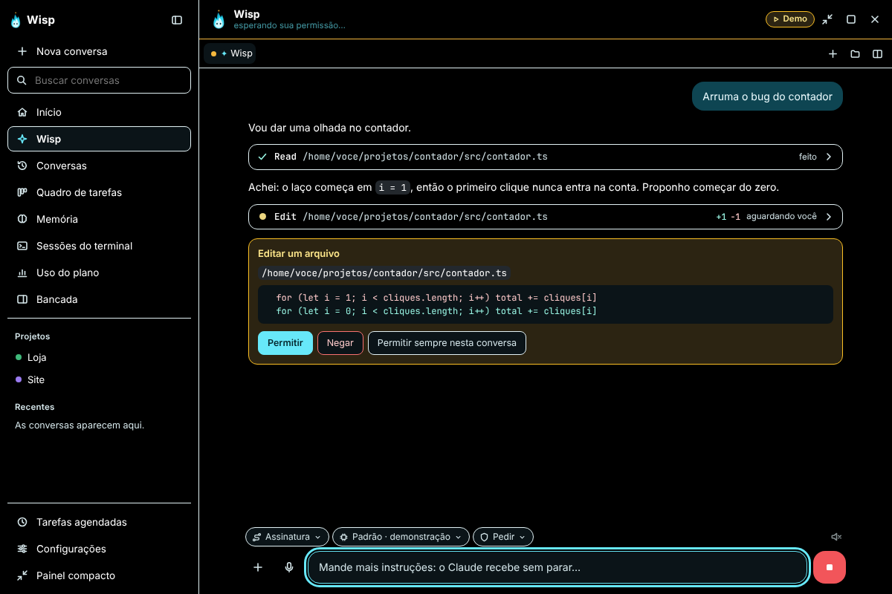</td>
  </tr>
</table>

### Chat and workbench

The conversation on the left, the workbench on the right. Here Claude found a bug and is waiting for
your OK on the edit, while the browser shows the project running on `localhost`.

<p align="center">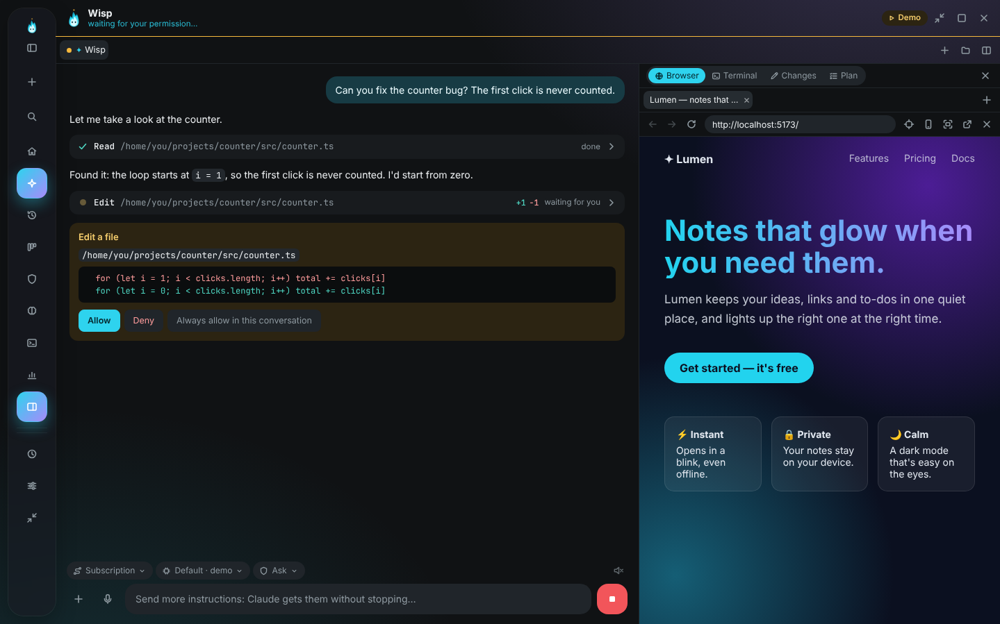</p>

### You decide

<table>
  <tr>
    <td width="55%">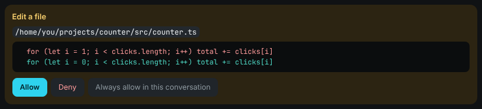</td>
    <td valign="top">
      <p>Anything that changes your machine stops at a card:</p>
      <ul>
        <li><b>Edits</b> show the diff (inline or side by side, in the VS Code editor)</li>
        <li><b>Commands</b> show exactly what will run</li>
        <li><b>Apps, links, windows, screenshots</b> — the same card</li>
        <li><b>Always allow in this conversation</b> understands commands:
            <code>git status</code> does not unlock <code>git push</code></li>
        <li>A brand-new card ignores clicks for half a second, so a stray click approves nothing</li>
      </ul>
      <p>Pick how much Claude may do on its own with the mode pill (or <b>Shift+Tab</b>):
      <b>Ask</b>, <b>Accept edits</b>, <b>Plan</b> or <b>Automatic</b>.</p>
    </td>
  </tr>
</table>

### Many conversations at once

Tabs, and up to 8 panes in a grid — split with <b>Ctrl+\\</b> — in the light, dark or high-contrast theme.

<p align="center">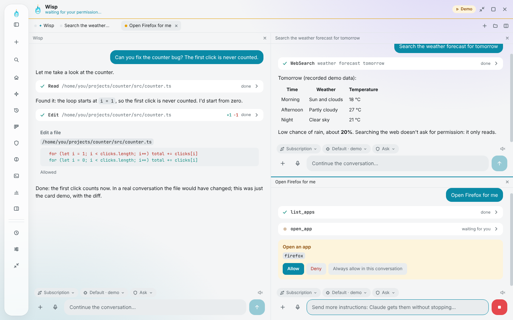</p>

### Everything one shortcut away

<table>
  <tr>
    <td width="50%" valign="top">
      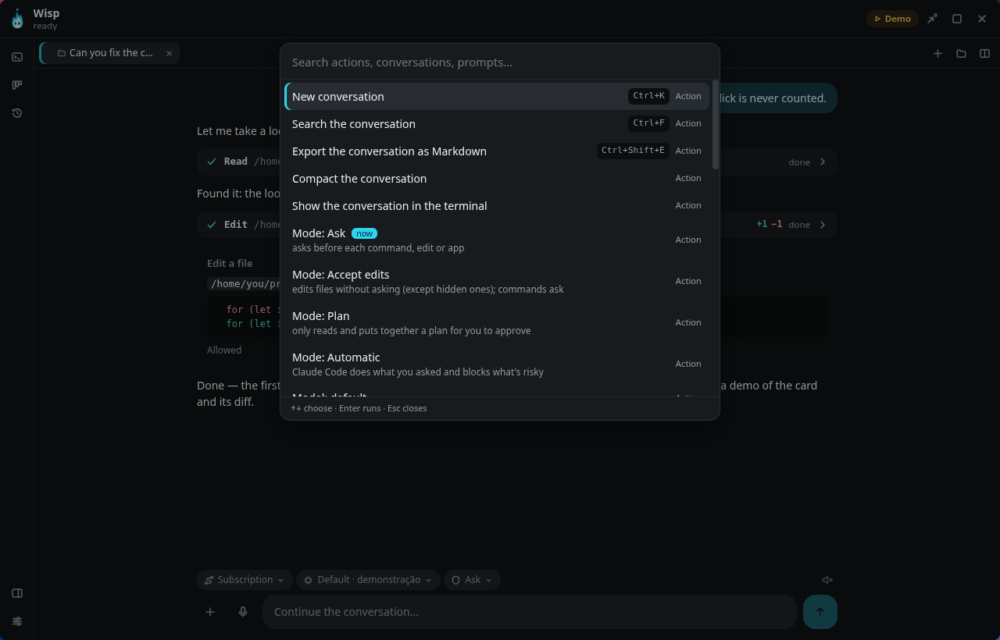
      <p align="center"><b>Command palette</b> (<b>Ctrl+P</b> in the panel, <b>Ctrl+Alt+P</b> anywhere): actions, conversations, modes, models and saved prompts.</p>
    </td>
    <td width="50%" valign="top">
      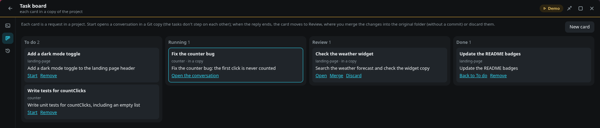
      <p align="center"><b>Task board</b>: each card runs in its own Git copy of the project; review, then <b>Merge</b> or <b>Discard</b>.</p>
    </td>
  </tr>
</table>

### A mascot with personality

Three avatars — the **will-o'-the-wisp**, the **jelly** and the **little ghost** — with 31 emotions that
Claude can show when they fit the conversation. It follows the cursor with its eyes, dances to your
music, naps without using CPU, and wears a hat at Christmas.

<p align="center">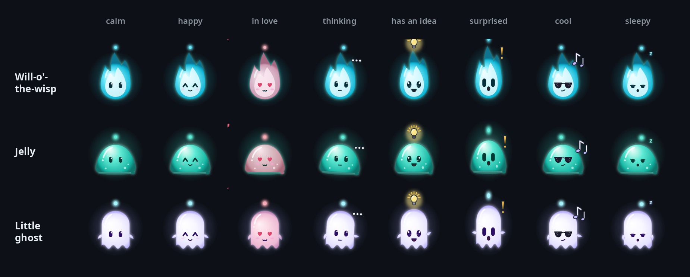</p>

<p align="center">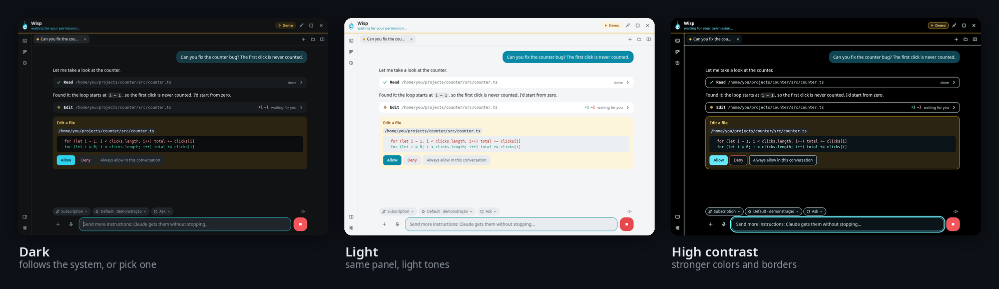</p>

<sub>All screenshots were taken in <b>demo mode</b> (the <b>Demo</b> badge in the header): the replies are
recorded, and the projects, skills and servers shown are examples.</sub>

## 📦 Install

> **Requirements:** Linux with **GNOME** or **KDE Plasma** (X11 or Wayland, through XWayland), or
> **Windows 10/11**; and [Claude Code](https://docs.claude.com/en/docs/claude-code) installed and
> logged in — run `claude` once in a terminal. Without it, Wisp opens in **demo mode**.

Packages (`.deb` and AppImage for x86-64 and ARM64, a Flatpak and the Windows installer) are built by
CI and attached to each tagged version on the [Releases](https://github.com/rempel/wisp/releases) page.
Until a version is tagged there, [build them from source](#from-source) — it takes a couple of minutes.

**Debian, Ubuntu and derivatives** — installs to `/opt/Wisp`, with the `wisp` command, a menu entry
and the AppArmor profile Ubuntu 23.10+ needs:

```bash
sudo apt install ./wisp_0.1.0_amd64.deb
```

**AppImage** — any distribution (built on Ubuntu 22.04, no `libfuse2` needed). The first run adds the
`wisp` command and the menu entry:

```bash
chmod +x Wisp-0.1.0-x86_64.AppImage
./Wisp-0.1.0-x86_64.AppImage
```

**Flatpak** — on top of Flathub's Electron base app (the sandbox is wide open on purpose, since Wisp
runs Claude Code, your terminal and your editor on the host; the [guide](docs/GUIA.md#flatpak) lists
every permission and why):

```bash
flatpak install --user Wisp.flatpak
flatpak run io.github.rempel.Wisp
```

**Windows** — run `Wisp-0.1.0-Setup-x64.exe` (or `-Setup-arm64.exe`). It installs for your user only,
no admin needed. Before that, install Claude Code and [Git for Windows](https://git-scm.com/download/win),
then run `claude` once to log in:

```powershell
irm https://claude.ai/install.ps1 | iex
```

> The installer isn't signed yet, so SmartScreen shows "Windows protected your PC":
> **More info → Run anyway**.

### From source

You need **Node.js 22.12+**, `git`, and `python3`, `make` and `g++` (to build `node-pty`):

```bash
git clone https://github.com/rempel/wisp.git
cd wisp
npm ci
npm start          # production build, then opens Wisp
```

```bash
npm run dev        # with hot reload
npm run dist       # .deb and AppImage in dist/
npm run dist:win   # the Windows installer (on Windows)
```

On **Ubuntu 24.04+**, AppArmor blocks Electron's sandbox inside `node_modules`; allow it once with
`npm run setup:apparmor`. Distro-specific packages (Fedora, Arch), `nvm`, ARM64 builds and the
end-to-end test dependencies are in the [full guide](docs/GUIA.md#compilar-a-partir-do-código).

### Optional extras

| Feature                         | Needs                                                                                                                          |
| ------------------------------- | ------------------------------------------------------------------------------------------------------------------------------ |
| Voice                           | A microphone, [whisper.cpp](https://github.com/ggml-org/whisper.cpp) (`whisper-cli`) and a model — see [Talk to it](#-recipes) |
| Spoken replies                  | [Piper](https://github.com/OHF-Voice/piper1-gpl) and a voice                                                                   |
| Volume by voice                 | `wpctl` (PipeWire) or `pactl`                                                                                                  |
| Global shortcuts on Wayland     | The `GlobalShortcuts` portal (GNOME 48+, KDE Plasma 5.27+)                                                                     |
| Bringing windows to the front   | KDE (X11 or Wayland) or any desktop on X11                                                                                     |
| GitHub / GitLab alerts          | [`gh`](https://cli.github.com) / [`glab`](https://gitlab.com/gitlab-org/cli) logged in                                         |
| Calendar                        | GNOME's calendars (Google and Microsoft via Online Accounts), an iCal address or `.ics` files                                  |
| Claude's own browser            | Chrome, Chromium, Brave, Edge or Vivaldi (not from Snap)                                                                       |
| Tray icon on GNOME (non-Ubuntu) | The _AppIndicator and KStatusNotifierItem Support_ extension                                                                   |

## ⚙️ Settings

Click the **sliders icon** at the bottom of the side bar (or search for it in the palette). It's one
scrolling page with a search box and 16 sections; everything is optional, and the defaults just work.
Everything is saved in `~/.config/wisp/config.json` (`%APPDATA%\Wisp` on Windows).

### Conversations — model, permissions and folders

The model and permission mode new conversations start with (each tab changes its own in the pills
below the text box), the folders where your projects live, the command that opens your editor, the
terminal Claude opens, after how long an idle tab's Claude Code process goes to sleep, and tools
that may run without a card.

<p align="center">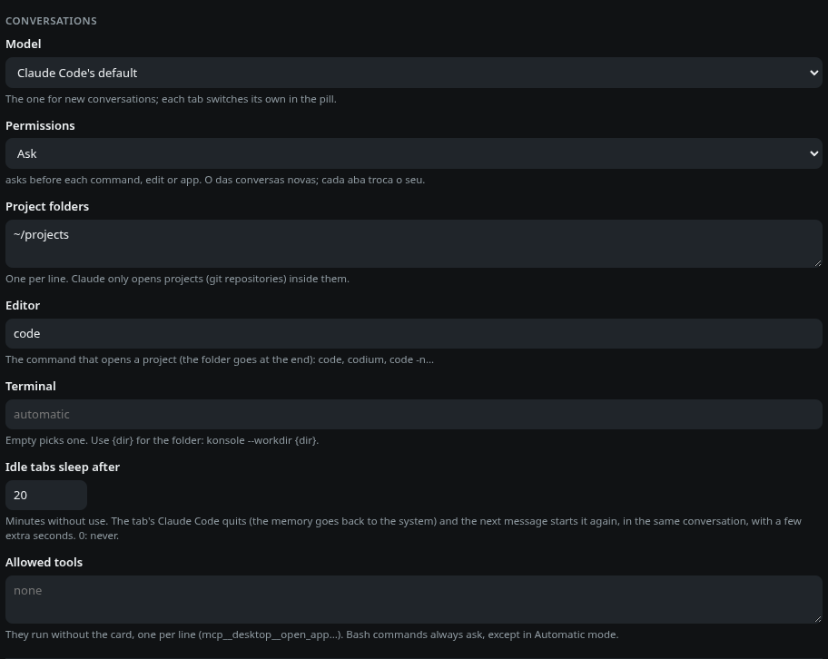</p>

### Mascot and sounds — make it yours

The **avatar**, the **dance** for when music plays, a gallery to preview every **emotion** and **dance**,
the **island** instead of the floating mascot, **sounds** and volume, how long until it naps, the
seasonal **accessory**, and the small helpers around the chat: the _use what you copied_ chip,
**review at the end of each reply**, internet pages in the workbench, _Ask Wisp_ in the file manager,
Wisp in the **desktop search** (KRunner, GNOME) and the GNOME Shell extension.

<p align="center">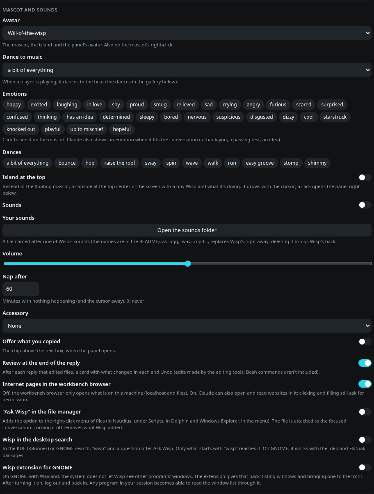</p>

To replace a sound, drop a file named after it in `~/.config/wisp/sounds/` — `abrir`, `fechar`,
`enviar`, `pronto`, `pedido`, `erro`, `cutucada`, `tonto`, `carinho`, `oi`, `absorver` or `lembrete`
(`.ogg`, `.wav`, `.mp3`, `.flac`, `.opus`… up to 2 MB). It applies right away; delete it to get Wisp's back.

### Appearance and accessibility

Language (system, English or Português), theme (system, light, dark), **high contrast**, **reduce
animations** and the panel size (also **Ctrl+plus / Ctrl+minus / Ctrl+0**).

<p align="center">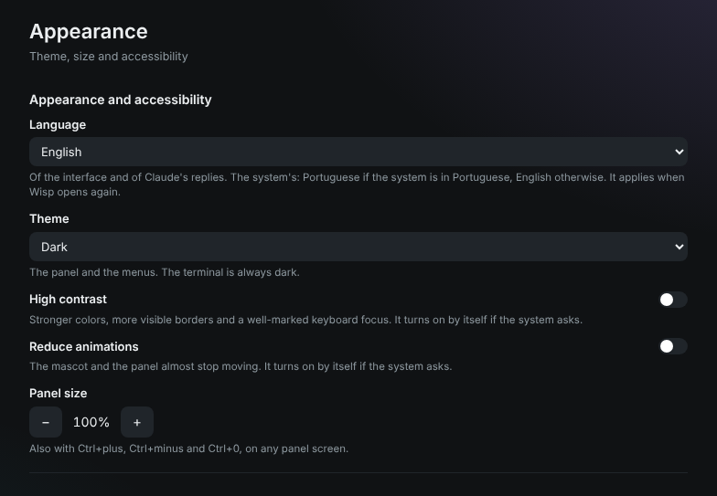</p>

### Shortcuts and system

Every global shortcut — open the panel, talk, palette, ask from the island, crop an area, explain the
selection, show the front window, dictate into any program — plus dictation replacements, answering
from the notification, staying quiet with _Do not disturb_, **quiet hours** and starting with the system.

<p align="center">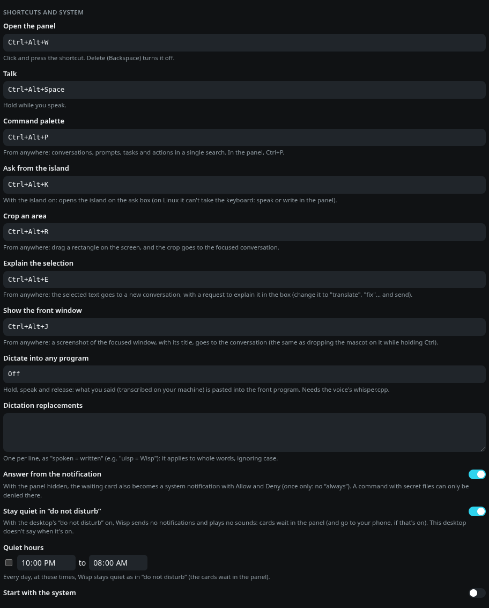</p>

<details>
<summary><b>Saved prompts and scheduled tasks</b> — <code>/diff</code>, <code>/commit</code>, <code>/explain</code>… and prompts on a timer</summary>
<br>
Saved prompts appear in the <code>/</code> menu, with variables filled in for you: <code>{folder}</code>,
<code>{clipboard}</code>, <code>{date}</code> and <code>{time}</code>. A scheduled task runs a prompt at a time or when
something happens (a review, a red CI, a new file, the screen unlocked), always in a new tab in Ask mode —
anything that changes your computer waits for your click.
<p align="center">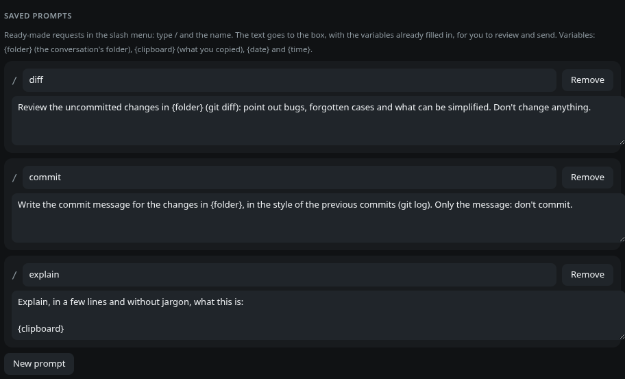</p>
<p align="center">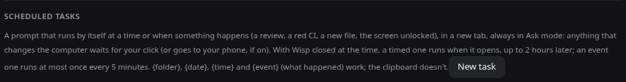</p>
</details>

<details>
<summary><b>Voice</b> — speech language, review before sending, quick commands, spoken replies</summary>
<br>
Quick commands for music, volume and opening apps (in Portuguese: “pausa a música”, “aumenta o volume”,
“abre o Firefox”) work without Claude and without the internet.
<b>Test voice</b> records 3 s and shows what whisper.cpp understood, how loud it was and how long it took.
<p align="center">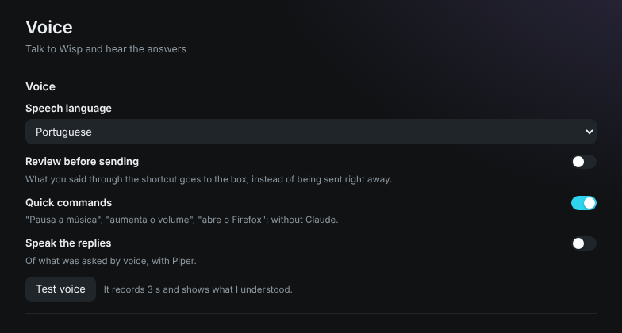</p>
</details>

<details>
<summary><b>Projects, skills, subagents and MCP servers</b> — what Claude Code brings to each conversation</summary>
<br>
<b>Projects</b> give a folder a name, a color for its tabs and its usual permission mode.
<b>Skills</b> lists your personal and plugin skills and installs one from a folder.
<b>Subagents</b> lists, previews, edits and removes your Claude Code subagents.
<b>MCP servers</b> lists the servers in your Claude Code and lets you choose which ones join Wisp's
conversations; adding or removing one shows the diff of <code>~/.claude.json</code> first and keeps a backup.
<p align="center">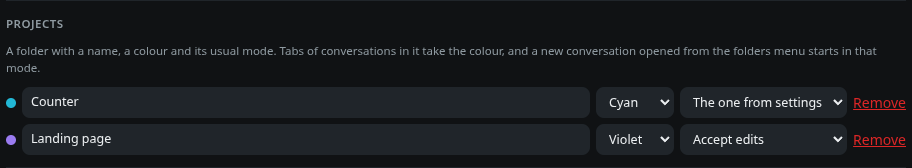</p>
<p align="center">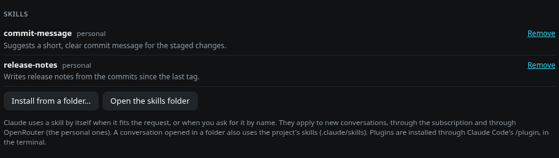</p>
<p align="center">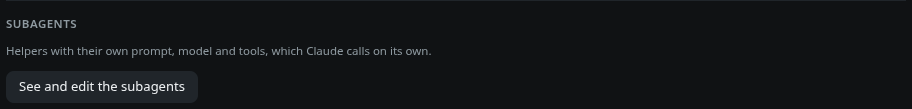</p>
<p align="center">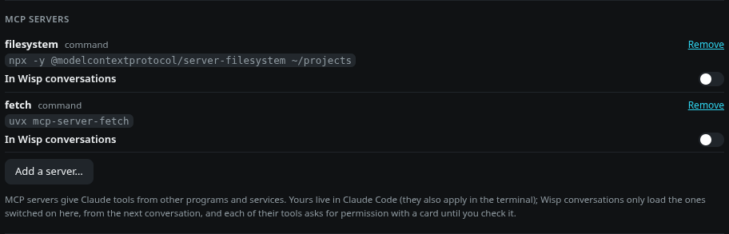</p>
</details>

<details>
<summary><b>OpenRouter (experimental)</b> — other models through Claude Code, or a local model server</summary>
<br>
New conversations can go through your Claude subscription (the default) or through
<a href="https://openrouter.ai">OpenRouter</a> with your key — kept in the system keyring, never in
<code>config.json</code>. A <b>local model server</b> (Ollama, LM Studio) with an Anthropic-compatible API works too.
Claude Code is still the brain; tools, permissions and cards work the same.
<p align="center">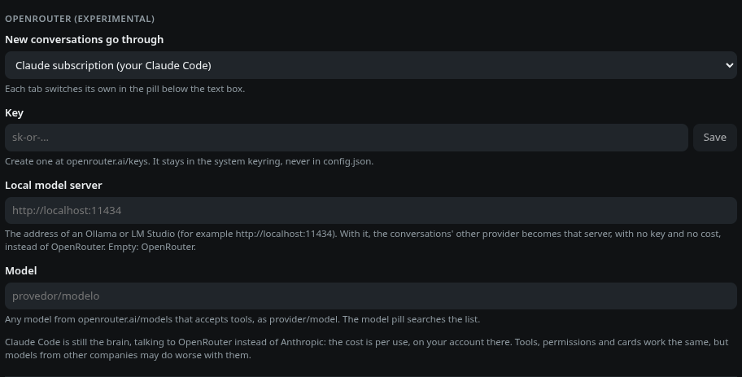</p>
</details>

<details>
<summary><b>Integrations</b> — GitHub, GitLab, calendar, weekly summary, plan usage</summary>
<br>
CI and reviews of your PRs (through <code>gh</code>), GitLab pipelines (through <code>glab</code>), upcoming
events, a Monday summary of the week (counts only, no content) and an alert at 80% and 95% of your plan's limits.
All off by default except the summary and the usage alert.
<p align="center">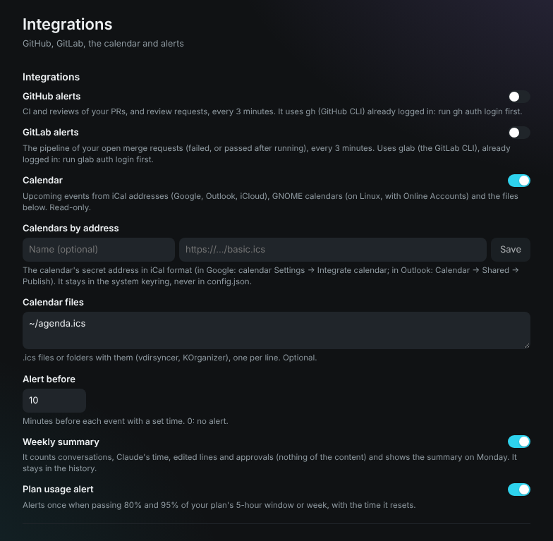</p>
</details>

<details>
<summary><b>Phone</b> — approve from your phone, or chat from it on your home network</summary>
<br>
Pair a phone with a QR code and the waiting card goes to it through <a href="https://ntfy.sh">ntfy</a> when the
screen is locked or after N seconds, with <b>Allow</b> and <b>Deny</b>. One request at a time, only a summary in
the channel, denied after 2 minutes with no answer, never “always”. Separately, <b>chat from the phone</b> opens a
page on your local network with the conversations, the cards and new chats.
<p align="center">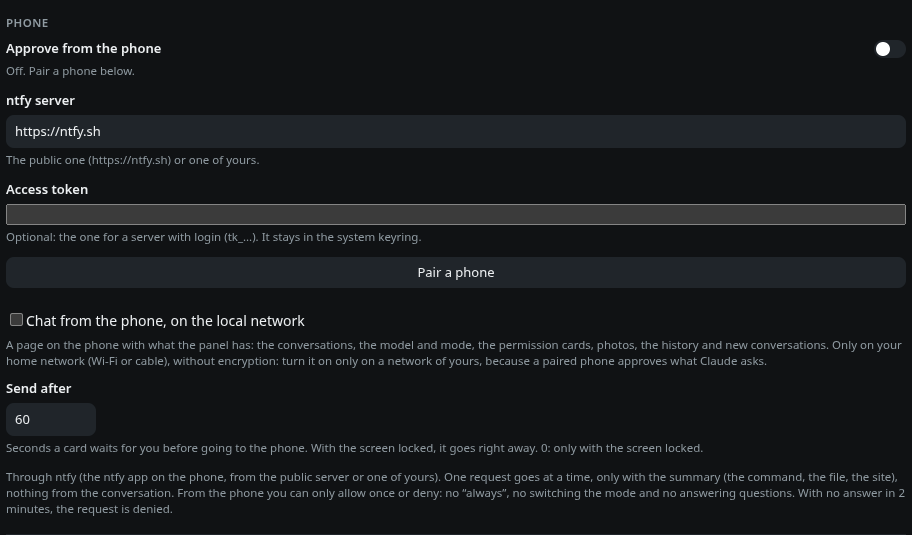</p>
</details>

<details>
<summary><b>Take Wisp with you</b> — export and import</summary>
<br>
One file with your settings, saved prompts, tasks and (if you tick it) your conversations. Never the keys:
the OpenRouter key and the phone pairing stay in the keyring. Importing shows what will change first and
backs up your <code>config.json</code>.
<p align="center">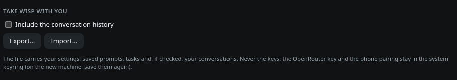</p>
</details>

<details>
<summary><b>Advanced</b> — diagnostics, first steps, updates, Claude's browser, demo mode</summary>
<br>
<b>Diagnostics</b> checks Claude Code, the shortcut, the tray, the keyring and the voice, and copies a
report with no personal data. <b>First steps</b> walks you through setup again. Also: a daily check for a
new version (off by default), a separate browser Claude can control (with permission per site),
<b>demo mode</b>, and links to <code>config.json</code> and the log.
<p align="center">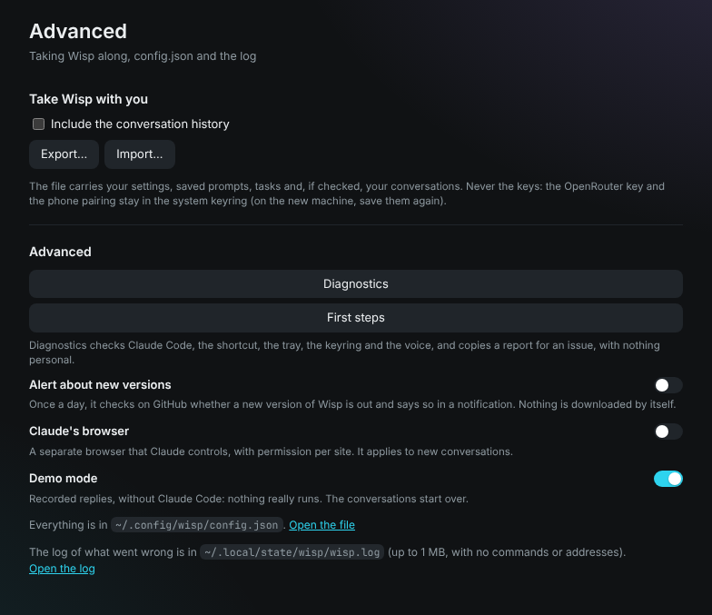</p>
</details>

The [full guide](docs/GUIA.md#configuração) documents every key of `config.json`.

## 🍳 Recipes

<details>
<summary><b>Let Claude edit, then review everything at the end</b></summary>
<br>
Switch the conversation to <b>Accept edits</b> (the mode pill, or <b>Shift+Tab</b> in the text box). Claude edits files
in your home and projects without asking — hidden files like <code>.env</code>, <code>.git</code> or <code>~/.bashrc</code>
still ask, and so do commands. With <b>Review at the end of the reply</b> on (Settings → Mascot and sounds), each reply
that edited files ends with a card listing them (+N −M and the diff) with <b>Open</b> and <b>Undo</b>, one by one or all.
</details>

<details>
<summary><b>Two tasks in the same repository, at the same time</b></summary>
<br>
Open the folder menu (the folder icon next to the tabs), tick <b>In a copy (Git worktree)</b> and pick the project.
The conversation works on its own branch (<code>wisp/…</code>); the bar on top shows what changed, and
<b>Merge into the original folder</b> brings the changes back (without a commit) or <b>Discard</b> removes the copy.
For several tasks, use the <b>task board</b>: each card's <b>Start</b> does the same, and the card moves to
<b>Review</b> when the reply ends.
</details>

<details>
<summary><b>See your web app while Claude works on it</b></summary>
<br>
Open the workbench (<b>Ctrl+Shift+B</b>), type <code>localhost:5173</code> (or a file: HTML, PDF, image) in the
address bar, or start the project's server from the <b>Terminal</b> tab — a <code>localhost</code> link in its output
opens in the browser next to it. Ask Claude to “check the page” and it can open, screenshot, read the console,
click and fill forms there. <b>Pick an element</b> sends what you point at to the conversation.
</details>

<details>
<summary><b>Talk to it</b> — whisper.cpp in five commands</summary>
<br>
Transcription runs on your machine. Install whisper.cpp and the <code>small</code> model (~470 MB; <code>base</code>
is faster and less accurate):

```bash
git clone https://github.com/ggml-org/whisper.cpp ~/whisper.cpp
cd ~/whisper.cpp
cmake -B build && cmake --build build -j --config Release
sh ./models/download-ggml-model.sh small
mkdir -p ~/.local/share/wisp/voz && mv models/ggml-small.bin ~/.local/share/wisp/voz/
```

Then hold <b>Ctrl+Alt+Space</b> and speak (a quick tap listens until you stop). Settings → Voice → <b>Test voice</b>
checks everything. For spoken replies, install Piper (<code>pipx install piper-tts</code>) and put a voice
(<code>.onnx</code> + <code>.onnx.json</code>) in the same folder. Windows steps are in the
<a href="docs/GUIA.md#voz">full guide</a>.
</details>

<details>
<summary><b>Approve from your phone while you're away</b></summary>
<br>
Install the ntfy app on your phone. In Settings → Phone, click <b>Pair a phone</b>, scan the QR code, subscribe, and
confirm the test notification — only then it turns on. From now on, a card that waits longer than
<b>Send after</b> (60 s by default), or any card while the screen is locked, reaches your phone. Use your own ntfy
server if you don't want requests passing through ntfy.sh.
</details>

## ❓ FAQ

<details>
<summary><b>Do I need an API key? Who pays?</b></summary>
<br>
No key: Wisp runs your Claude Code with <b>your Claude subscription</b>. It even starts Claude Code without
<code>ANTHROPIC_API_KEY</code> in the environment, so you aren't billed per use by surprise — and warns you if Claude
Code uses a key anyway. OpenRouter (experimental) is the only option that uses a key, and it's opt-in.
</details>

<details>
<summary><b>Can I try it without Claude Code?</b></summary>
<br>
Yes. Without Claude Code, Wisp offers <b>demo mode</b> (also in Settings → Advanced): recorded replies show the
cards, the diff and the tools, and nothing really runs on your computer.
</details>

<details>
<summary><b>Does Wisp send anything anywhere?</b></summary>
<br>
No telemetry. The network is Claude Code's own, plus what you turn on: <code>gh</code>/<code>glab</code>, calendars,
Claude's browser, ntfy for phone approvals, and — if you enable it — one daily check for new versions on GitHub.
Chat from the phone opens a port on your local network only while it's on.
</details>

<details>
<summary><b>Can Claude run something dangerous without me noticing?</b></summary>
<br>
Not through Wisp. Everything that changes something goes through a card; <code>--dangerously-skip-permissions</code> is
never used; reading secret files (<code>~/.ssh</code>, <code>~/.aws</code>, <code>.env</code>…) always asks; by voice you can
deny, never approve; from the phone only “allow once”. The desktop tools listen on <code>127.0.0.1</code> only, with a
new token every launch, and run programs with argument lists — never through a shell. A project that runs commands
on its own (hooks, permissions, skills with <code>allowed-tools</code>) only opens after you trust it.
</details>

<details>
<summary><b>Does it work on Wayland?</b></summary>
<br>
Yes, on GNOME and KDE Plasma, through XWayland (which both ship): on Wayland a native app can't choose its own
position or stay on top. Global shortcuts go through the <code>GlobalShortcuts</code> portal (the desktop asks you
once), screenshots through the capture portal. On GNOME with Wayland, bringing other apps' windows to the front
needs the optional Wisp GNOME Shell extension.
</details>

<details>
<summary><b>Does it replace the Claude Code terminal?</b></summary>
<br>
It lives alongside it. The <b>Terminal sessions</b> view lists the Claude Code sessions you run in a terminal, tells
you when one needs you, lets you approve from the card and continue a session in the chat. Any chat tab can switch
to <b>terminal mode</b> and back.
</details>

<details>
<summary><b>Where is my data?</b></summary>
<br>
Settings in <code>~/.config/wisp/config.json</code>; conversations, tabs, reminders and the voice models in
<code>~/.local/share/wisp/</code>; the log (max 1 MB, without commands, addresses, keys or tokens) in
<code>~/.local/state/wisp/wisp.log</code>; secrets in the system keyring. On Windows, <code>%APPDATA%\Wisp</code> and
<code>%LOCALAPPDATA%\Wisp</code>. The complete table is in the <a href="docs/GUIA.md#privacidade-e-segurança">guide</a>.
</details>

<details>
<summary><b>Is this an Anthropic product?</b></summary>
<br>
No. Wisp is an independent, community project; it uses Claude Code as it is installed on your computer.
</details>

## 🛠️ Development

Wisp is an [Electron](https://www.electronjs.org) app in TypeScript and React, built with
[electron-vite](https://electron-vite.org) and packaged with [electron-builder](https://www.electron.build).

```
src/
  main/              the Electron main process
    index.ts         app lifecycle, single instance, wiring of every feature
    claude*.ts       the `claude -p` process: stream-json, state, settings, finding the CLI
    conversation.ts  one conversation (tab): process, history, cards, "always", mode
    mcp-server.ts    the `desktop` MCP server (127.0.0.1 + token): apps, windows, reminders…
    mcp-workbench.ts Claude's tools for the workbench: preview_* and terminal_*
    tui.ts           terminal mode: the real Claude Code in a pseudo-terminal (node-pty)
    hooks/           the relay Claude Code runs on each hook, and the socket that receives it
    voice*.ts        whisper.cpp, Piper and the quick commands
    demo/            the recorded Claude Code of demo mode
  preload/           the bridge between pages and main (window.wisp)
  renderer/
    chat/            the panel: conversations, grid, workbench, settings, palette, board
    mascot/          the mascot, its emotions and dances, and the island
    area/            the crop-an-area overlay
  shared/            types, IPC contracts, layout, i18n (pt-BR source strings + English dictionary)
resources/           icon, demo recordings, the Wisp persona (CLAUDE.md)
build/               packaging: .deb, AppImage, Flatpak, Windows, AppArmor
test/                unit tests (node --test), with a fake Claude Code in test/fixtures
e2e/                 end-to-end scripts, driven over the DevTools protocol in Xvfb
docs/                the full guide, architecture, phase history, validation scripts
```

| Command             | What it does                                                             |
| ------------------- | ------------------------------------------------------------------------ |
| `npm run dev`       | Opens the app with hot reload                                            |
| `npm start`         | Production build, then opens it                                          |
| `npm run build`     | Type-checks and builds into `out/`                                       |
| `npm run typecheck` | Types of main/preload and of the pages                                   |
| `npm run lint`      | ESLint                                                                   |
| `npm run format`    | Prettier                                                                 |
| `npm test`          | Unit tests (`npm test -- stream terminal` runs only those)               |
| `e2e/run.sh`        | End-to-end tests in a virtual X server with their own D-Bus              |
| `npm run dist`      | `.deb` and AppImage in `dist/` (`dist:deb`, `dist:appimage`, `dist:win`) |
| `npm run i18n`      | Lists interface strings still missing an English translation             |

CI (GitHub Actions) runs types, lint, formatting, unit and end-to-end tests on every push, builds and smoke-tests
the `.deb`, AppImage, ARM64 packages, Flatpak and the Windows installer, and attaches them to a release on `v*` tags.
How everything works inside is in [docs/ARQUITETURA.md](docs/ARQUITETURA.md).

### Translating

The interface is written in Portuguese and translated through a dictionary: the English strings live in
`src/shared/i18n-en.ts`. `npm run i18n` lists what's missing, and `test/idiomas.test.ts` fails if any string has no
translation. Today Wisp speaks those two; a third language needs its own dictionary plus small changes in
`src/shared/i18n.ts` (the `Locale` type, the system-language detection and `t()`).

### Contributing

Issues and pull requests are welcome. Read [CONTRIBUTING.md](CONTRIBUTING.md) (how to build, test and where each part
lives), check the [Roadmap](ROADMAP.md) for what's planned and the [changelog](CHANGELOG.md) for what changed.

## 💜 Credits

Wisp exists because of [Claude Code](https://docs.claude.com/en/docs/claude-code), and is built with
[Electron](https://www.electronjs.org), [React](https://react.dev), [xterm.js](https://xtermjs.org),
[node-pty](https://github.com/microsoft/node-pty), [Monaco](https://microsoft.github.io/monaco-editor/), the
[MCP SDK](https://github.com/modelcontextprotocol/typescript-sdk), [Playwright MCP](https://github.com/microsoft/playwright-mcp),
[whisper.cpp](https://github.com/ggml-org/whisper.cpp) and [Piper](https://github.com/OHF-Voice/piper1-gpl).
The mascot's emotions, signs, dances and cartoon swap come from
[ClaudeAnimationBase](https://github.com/JohnHeibel/ClaudeAnimationBase) by John Heibel (MIT), redrawn in SVG and
CSS for the wisp, the jelly and the little ghost.

## 📄 License

[GPL-3.0-or-later](LICENSE). An assistant that acts on your computer should be auditable: every copy of Wisp
that reaches someone, modified or not, comes with its source code.

---

## 🇧🇷 Português

**O Claude Code fora do terminal.** Um fogo-fátuo que flutua na sua tela, conversa com você e age no seu
computador — com o seu `claude`, a sua assinatura e um clique seu antes de qualquer mudança.

- 🔥 **Sempre à mão:** um clique no mascote, **Ctrl+Alt+W** ou a voz abrem a conversa; o mascote mostra se está pensando, falando ou esperando você. Ou troque-o pela **ilha** no topo da tela.
- 🧠 **O Claude Code de verdade:** ferramentas, modos, skills, plugins, `CLAUDE.md` e sessões são os mesmos do terminal, e uma aba pode virar o **modo terminal**.
- 🛡️ **Nada muda sem um clique seu:** cada comando, edição ou app vira um card com **Permitir** e **Negar** (e o diff). Pular as permissões não existe.
- 🧪 **A bancada:** navegador e terminal ao lado da conversa, com as abas **Mudanças** e **Plano**; o Claude também usa os dois.
- 🖥️ **Assistente de desktop:** apps, links, janelas, print, música, lembretes, agenda e o CI dos seus PRs, no GNOME, no KDE e no Windows.
- 🗂️ **Em paralelo:** até 8 conversas lado a lado, conversas em cópias do Git e um **quadro de tarefas**.
- 🔒 **Seu, e só seu:** sem telemetria, voz transcrita na sua máquina, segredos no chaveiro do sistema.
- 🗃️ **A janela completa:** o painel compacto ao lado do mascote ou uma janela grande com a barra lateral (busca, Início, a Wisp, projetos e recentes), o **Início** com o seu dia e as configurações em categorias.
- 🧭 **Um assistente que lembra:** a memória pessoal, a conversa **Wisp** de cada dia, o **batimento**, a agenda que ele marca, o **Telegram** e as skills que ele aprende.

### Instalação

Instale o pacote do seu sistema (os pacotes saem na página de [Releases](https://github.com/rempel/wisp/releases) a cada versão marcada; até lá, monte-os a partir do código):

```bash
sudo apt install ./wisp_0.1.0_amd64.deb
```

Ou, a partir do código:

```bash
git clone https://github.com/rempel/wisp.git
cd wisp
npm ci
npm start
```

Tenha o [Claude Code](https://docs.claude.com/en/docs/claude-code) instalado e logado (`claude` no terminal); sem ele, o Wisp abre no **modo demonstração**.
As configurações ficam no ícone de ajustes, no pé da barra lateral: Conversas, Prompts salvos, Tarefas agendadas, Mascote e sons,
Aparência e acessibilidade, Atalhos e sistema, Voz, Projetos, Skills, Subagentes, Servidores MCP, OpenRouter, Integrações,
Celular, Levar o Wisp junto e Avançado.

O **guia completo, em português**, com cada recurso, cada chave do `config.json`, os atalhos e os problemas comuns, está em
[docs/GUIA.md](docs/GUIA.md).

<p align="center"><sub>O Wisp é um projeto independente, feito pela comunidade; não é um produto da Anthropic.</sub></p>
